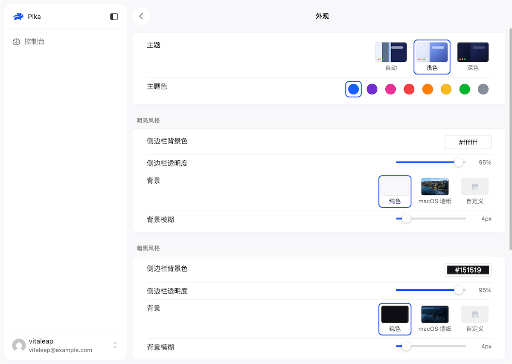
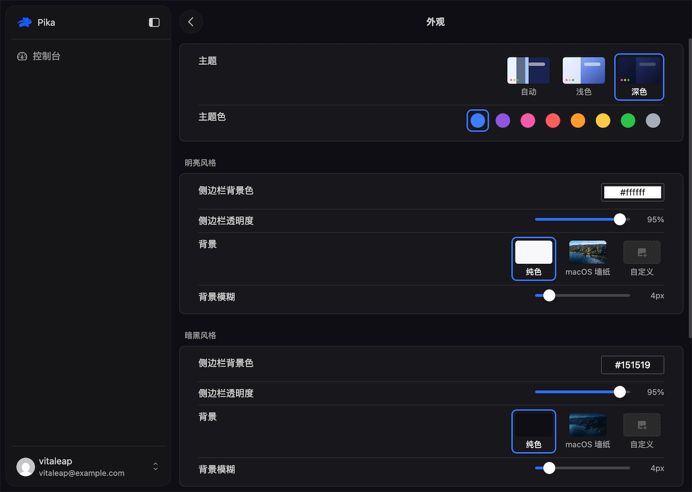
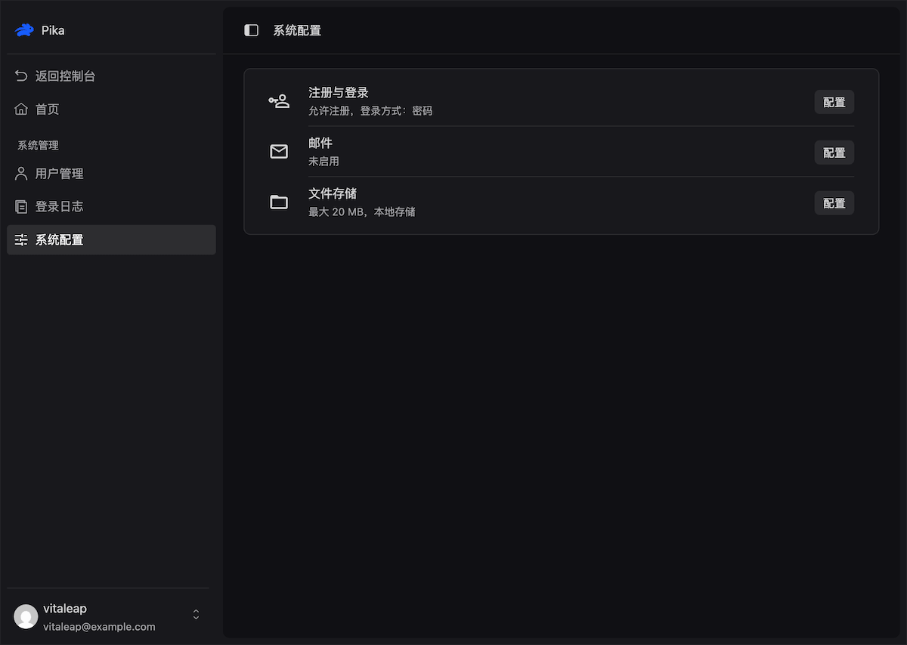

<p align="center">
  
</p>

<h1 align="center">Pika</h1>

<p align="center">
  <a href="./README.md">简体中文</a> | English
</p>

<p align="center">
  Pika is a small and fast full-stack starter kit with a built-in user system and admin system that work out of the box, so you can start building your own product right away.
  <br />
  <br />
  About the name: "pika" (ぴか) is Japanese for "sparkle, flash". It is also the name of the pika, a small, agile, lightning-fast mammal of the family Ochotonidae.
</p>

<p align="center">
  <a target="_blank" href="https://bun.com">
    
  </a>
  <a target="_blank" href="https://elysiajs.com">
    
  </a>
  <a target="_blank" href="https://orm.drizzle.team">
    
  </a>
  <a target="_blank" href="https://vuejs.org">
    
  </a>
  <a href="./LICENSE">
    
  </a>
  <a target="_blank" href="https://github.com/vitaleap/pika/stargazers">
    
  </a>
</p>

## Features

- **User system**: sign-up, sign-in (password / email code / SMS code), password recovery, captcha, JWT (access + refresh)
- **Account center**: profile and avatar, security settings (password / email / phone), appearance preferences (theme color / background / language), i18n (Chinese / English)
- **Admin system**: user management, system settings (auth / email / files), sign-in logs
- **Shared infrastructure**: request ID, structured logging, rate limiting, snowflake ID, timezone, i18n, email, file upload
- **Engineering**: full-stack TypeScript, Prettier formatting, type checking and tests, Docker and cross-compiled binaries via GitHub Release
- **Clear package layout**: reusable capabilities live in `packages/*`, business code only adds thin wrappers

## Screenshots

|                        Light theme                        |                       Dark theme                        |                         Admin system settings                         |
| :-------------------------------------------------------: | :-----------------------------------------------------: | :-------------------------------------------------------------------: |
|  |  |  |

## AI-friendly

A documentation system built for AI collaboration: the root `AGENTS.md` holds global conventions and an index, while topic-specific rules are split under `.agents/docs/`, so an agent only reads what is relevant to the current task.

- **Layered AGENTS.md**: the root defines global conventions and common commands; `apps` and `packages` each keep their own rules, and an agent reads the layer it is working in.
- **Progressive disclosure**: `AGENTS.md` keeps only global conventions and an index, with links into `.agents/docs/` for modules, routes, services, and i18n. Details are loaded on demand, trading less context for changes that fit existing conventions.
- **Project-level skills**: `.agents/skills/` provides ready-to-load Agent Skills (`karpathy-guidelines` for coding discipline, `code-simplifier` for code simplification), turning engineering habits such as change scope and simplification criteria into reusable judgment.
- **Self-verifying loop**: `bun run check` (workspace-wide types + formatting) and `bun run test` (integration tests) let an agent verify its own changes.

## Tech stack

Built on Bun + TypeScript.

### Server

- **Framework**: Elysia
- **ORM**: Drizzle ORM
- **Database**: PostgreSQL or PGlite
- **Validation**: Zod
- **Auth**: @elysia/jwt
- **API docs**: @elysia/openapi
- **Logging**: pino + pino-pretty
- **Cache**: @seepine/cache
- **ID generation**: simple-flakeid
- **Dates**: dayjs
- **Email**: nodemailer

### Web

- **Framework**: Vue 3
- **Build tool**: Vite 8
- **UI library**: Naive UI + Naive Plus
- **Styling**: UnoCSS + Sass
- **State management**: Pinia 4
- **Routing**: Vue Router 5
- **HTTP client**: Alova
- **Other dependencies**: dayjs, es-toolkit

## Project structure

```ini
.agents/
  docs              # Project documentation
  skills            # Project-level skills
apps
  server/           # Server app, Elysia + Drizzle + PostgreSQL
  web/              # Web app, Vite + Vue3 + Naive-UI + UnoCSS
packages
  shared/           # Shared modules for server and web (@pika/shared)
  bun-plugins/      # Build-time Bun bundler plugins and build CLI (@pika/bun-plugins)
  elysia-common/    # Common Elysia server infrastructure: logging/ID/email/files (@pika/elysia-common)
  elysia-plugins/   # Runtime Elysia HTTP middleware collection (@pika/elysia-plugins)
  elysia-openapi/   # OpenAPI document generation plugin (@pika/elysia-openapi)
  elysia-hook/      # Application lifecycle management (start/stop hooks) (@pika/elysia-hook)
  rate-limit/       # Multi-window rate limiting helper (@pika/rate-limit)
  wrap-naive-ui/    # naive-ui wrappers (@pika/wrap-naive-ui)
docker/             # Dockerfile-related files
```

The server is split into two layers: `common/` (infrastructure such as db, hooks, plugins, and utils) and `src/` (business modules such as system and demo). The path alias `@/common/*` points to the infrastructure layer, and `@/*` points to `src/`.

## Getting started

Requirements: Bun (1.4+) [install](https://bun.com)

```bash
# Install dependencies
bun install

# Start server and web together
bun run dev
```

- Web: http://localhost:9527
- Server: http://localhost:9528
- OpenAPI docs: http://localhost:9528/api/openapi

Local development uses PGlite by default (data is stored in `apps/server/.tmp/`), so no separate database is needed.

See `apps/server/.env.example` for more environment variables.

## Common commands

```bash
bun run dev      # Development
bun run lint     # Code formatting
bun run check    # Type and lint checks
bun run test     # Tests
bun run build    # Build
bun run db:gen   # Generate database migrations
```

## Deployment

```bash
# All-in-one (nginx + server + PGlite, port 8080)
docker compose up --build

# Production split (web + server + redis + postgres, port 8080)
docker compose -f docker-compose.prod.yml up --build
```

You can also build a single executable with the web app embedded via `bun run build:web && bun run build:server --name=pika --embed-web`.

## More documentation

- Server guidelines: `apps/server/AGENTS.md`, `.agents/docs/server/`
- Web guidelines: `apps/web/AGENTS.md`, `.agents/docs/web/`
- Shared packages guidelines: `packages/AGENTS.md`
- Docker deployment: `docker/README.md`

## Contributing

Issues and pull requests are welcome. Please read [CONTRIBUTING.md](./CONTRIBUTING.en.md) first for the branch, commit message, and check workflow.

If you find a security issue, please do not open a public issue. Report it privately as described in [SECURITY.md](./SECURITY.en.md).

## License

[MIT](./LICENSE) © vitaleap

## Star history

<p align="center">
  <a target="_blank" href="https://star-history.com/#vitaleap/pika&Date">
    <picture>
      <source media="(prefers-color-scheme: dark)" srcset="https://api.star-history.com/svg?repos=vitaleap/pika&type=Date&theme=dark" />
      <source media="(prefers-color-scheme: light)" srcset="https://api.star-history.com/svg?repos=vitaleap/pika&type=Date" />
      
    </picture>
  </a>
</p>
