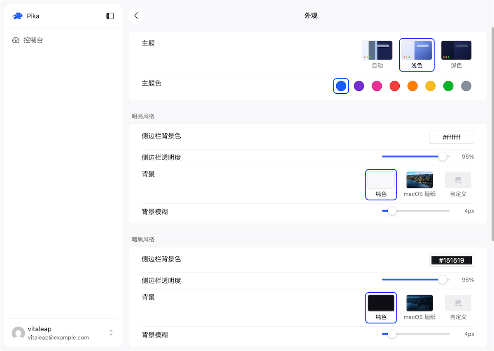
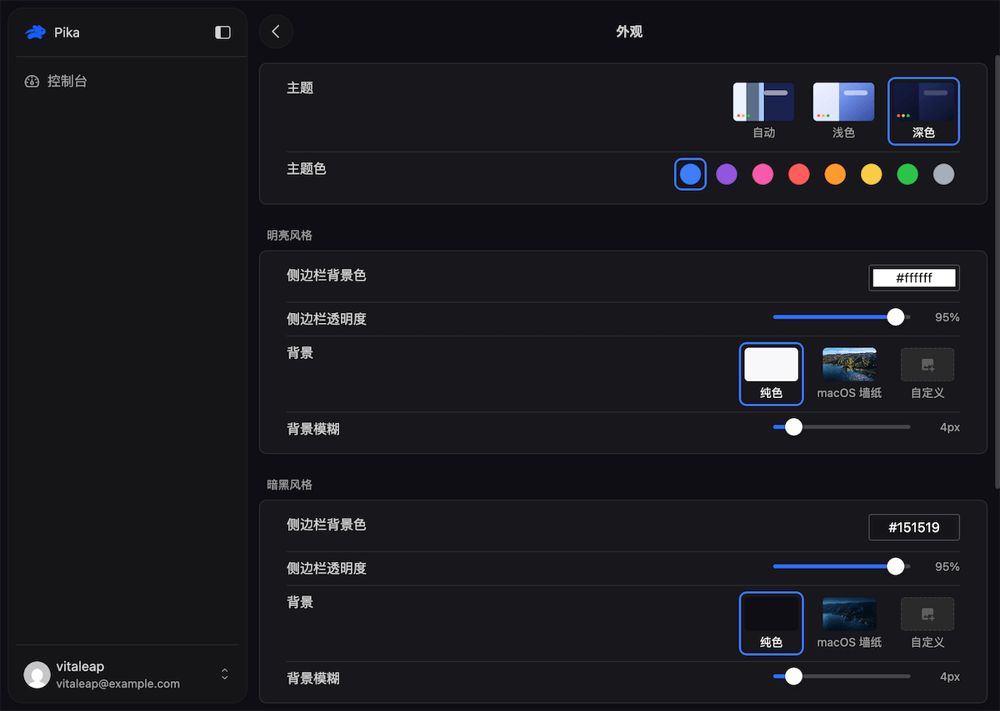
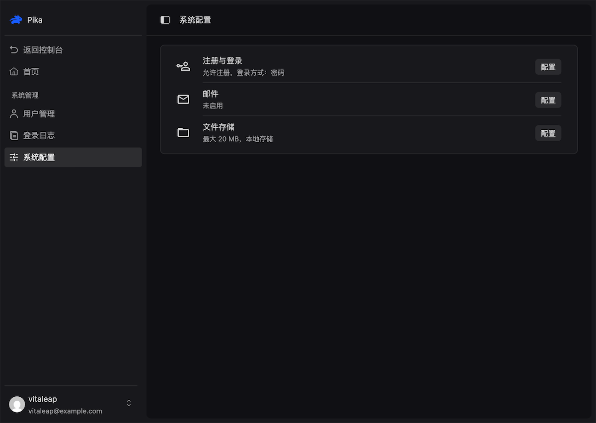

<p align="center">
  
</p>

<h1 align="center">Pika</h1>

<p align="center">
  简体中文 | <a href="./README.en.md">English</a>
</p>

<p align="center">
  Pika 是一个小而快的前后端一体脚手架，它内置了基础的用户体系与后台体系，开箱即用，你可以直接在此基础上快速构建自己的产品。
  <br />
  <br />
  名称由来：日语“ぴか”，意为“闪光、闪烁”，也指鼠兔科的动物，体型娇小、行动敏捷、快如闪电
</p>

<p align="center">
  <a target="_blank" href="https://bun.com">
    
  </a>
  <a target="_blank" href="https://elysiajs.com">
    
  </a>
  <a target="_blank" href="https://orm.drizzle.team">
    
  </a>
  <a target="_blank" href="https://cn.vuejs.org">
    
  </a>
  <a href="./LICENSE">
    
  </a>
  <a target="_blank" href="https://github.com/vitaleap/pika/stargazers">
    
  </a>
</p>

## 特性

- **用户体系**：注册、登录（密码 / 邮箱验证码 / 手机验证码）、找回密码、图形验证码、JWT（access + refresh）
- **个人中心**：资料与头像、安全设置（密码 / 邮箱 / 手机）、外观偏好（主题色 / 背景 / 语言）、多语言（中文 / English）
- **后台体系**：用户管理、系统配置（认证 / 邮件 / 文件）、登录日志
- **通用基础设施**：请求 ID、结构化日志、限流、雪花 ID、时区、i18n、邮件、文件上传
- **工程化**：TypeScript 全栈、Prettier 格式化、类型检查与测试、Docker 与 GitHub Release 交叉编译产物
- **包结构清晰**：可复用能力沉淀在 `packages/*`，业务代码只做薄封装

## 界面预览

|                        浅色主题                        |                       深色主题                        |                         后台系统配置                         |
| :----------------------------------------------------: | :---------------------------------------------------: | :----------------------------------------------------------: |
|  |  |  |

## AI 友好

面向 AI 协作的文档体系：根目录 `AGENTS.md` 给出全局约定与索引，具体规范按主题拆分在 `.agents/docs/` 中，Agent 只读取与当前任务相关的部分。

- **分层 AGENTS.md**：根目录定义全局约定与常用命令，`apps` 与 `packages` 各自维护目录内的规范，Agent 按所在层级读取对应说明。
- **渐进式披露**：`AGENTS.md` 只保留全局约定与索引，模块、路由、服务、国际化等细节以链接指向 `.agents/docs/`，按任务需要展开，用更少的上下文换来更贴合既有约定的改动。
- **项目级技能**：`.agents/skills/` 内置可直接加载的 Agent Skills（`karpathy-guidelines` 编码准则、`code-simplifier` 代码简化），把改动范围、简化标准等工程习惯固化为可复用的判断。
- **可自验证闭环**：`bun run check`（全仓类型 + 格式）与 `bun run test`（集成测试）让 Agent 改完即可自行验证。

## 技术栈

本项目基于 Bun + TypeScript

### Server

- **框架**: Elysia
- **ORM**: Drizzle ORM
- **数据库**: PostgreSQL 或 PGlite
- **验证**: Zod
- **认证**: @elysia/jwt
- **API 文档**: @elysia/openapi
- **日志**: pino + pino-pretty
- **缓存**: @seepine/cache
- **ID 生成**: simple-flakeid
- **日期**: dayjs
- **邮件**: nodemailer

### Web

- **框架**: Vue 3
- **构建工具**: Vite 8
- **UI 组件库**: Naive UI + Naive Plus
- **CSS 方案**: UnoCSS + Sass
- **状态管理**: Pinia 4
- **路由**: Vue Router 5
- **请求库**: Alova
- **其他依赖**: dayjs、es-toolkit

## 项目结构

```ini
.agents/
  docs              # 项目相关文档
  skills            # 项目级技能
apps
  server/           # 服务端项目, Elysia + Drizzle + PostgreSQL
  web/              # 网页端项目, Vite + Vue3 + Naive-UI + UnoCSS
packages
  shared/           # 前后端共享模块 (@pika/shared)
  bun-plugins/      # 构建时 Bun bundler plugin 集合与构建 CLI (@pika/bun-plugins)
  elysia-common/    # Elysia server 通用基础设施：日志/ID/邮件/文件 (@pika/elysia-common)
  elysia-plugins/   # 运行时 Elysia 通用 HTTP 中间件集合 (@pika/elysia-plugins)
  elysia-openapi/   # OpenAPI 文档生成插件 (@pika/elysia-openapi)
  elysia-hook/      # 应用生命周期管理（启动/关闭钩子）(@pika/elysia-hook)
  rate-limit/       # 多窗口限流 helper (@pika/rate-limit)
  wrap-naive-ui/    # naive-ui 二次封装 (@pika/wrap-naive-ui)
docker/             # dockerfile 相关文件
```

服务端目录分为 `common/`（基础设施，如 db、hooks、plugins、utils）与 `src/`（业务模块，如 system、demo）两层，路径别名 `@/common/*` 指向基础设施，`@/*` 指向 `src/`。

## 快速开始

环境要求：Bun（1.4+）[前往安装](https://bun.com)

```bash
# 安装依赖
bun install

# 同时启动 server 与 web
bun run dev
```

- Web：http://localhost:9527
- Server：http://localhost:9528
- OpenAPI 文档：http://localhost:9528/api/openapi

本地开发默认使用 PGlite（数据落在 `apps/server/.tmp/`），无需额外安装数据库。

更多环境变量见 `apps/server/.env.example`。

## 常用命令

```bash
bun run dev      # 开发
bun run lint     # 代码格式化
bun run check    # 类型与规范检查
bun run test     # 测试
bun run build    # 构建
bun run db:gen   # 生成数据库迁移
```

## 部署

```bash
# 单机一体（nginx + server + PGlite，端口 8080）
docker compose up --build

# 生产拆分（web + server + redis + postgres，端口 8080）
docker compose -f docker-compose.prod.yml up --build
```

也可以通过 `bun run build:web && bun run build:server --name=pika --embed-web` 编译为内嵌前端的单文件可执行程序。

## 更多文档

- 服务端规范：`apps/server/AGENTS.md`、`.agents/docs/server/`
- 前端规范：`apps/web/AGENTS.md`、`.agents/docs/web/`
- 公共包规范：`packages/AGENTS.md`
- Docker 部署：`docker/README.md`

## 贡献

欢迎提交 Issue 与 Pull Request。提交前请阅读 [CONTRIBUTING.md](./CONTRIBUTING.md)，了解分支、提交信息与检查流程。

发现安全问题时请勿公开提交 Issue，请按 [SECURITY.md](./SECURITY.md) 的方式私下报告。

## 许可证

[MIT](./LICENSE) © vitaleap

## Star 趋势

<p align="center">
  <a target="_blank" href="https://star-history.com/#vitaleap/pika&Date">
    <picture>
      <source media="(prefers-color-scheme: dark)" srcset="https://api.star-history.com/svg?repos=vitaleap/pika&type=Date&theme=dark" />
      <source media="(prefers-color-scheme: light)" srcset="https://api.star-history.com/svg?repos=vitaleap/pika&type=Date" />
      
    </picture>
  </a>
</p>
